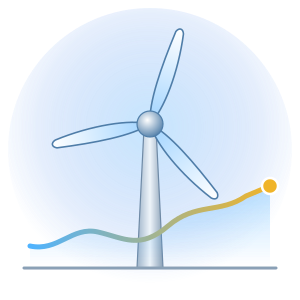
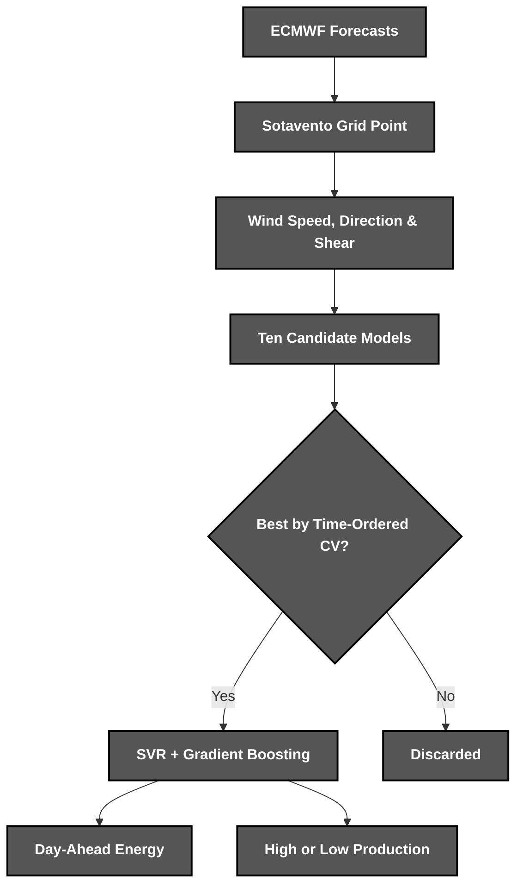
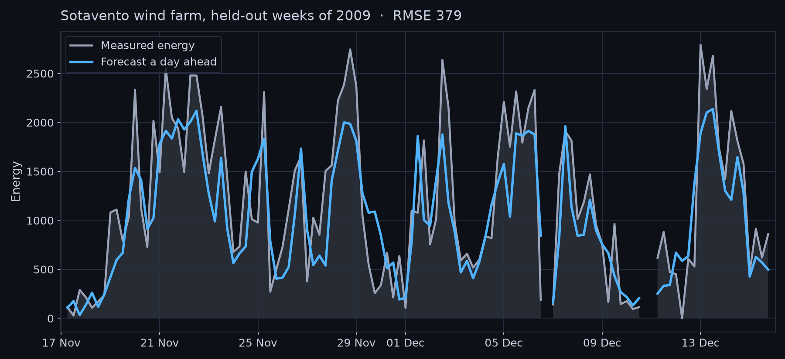

<div align="center">



*A day-ahead **wind energy** forecaster for the **Sotavento** wind farm*

</div>

# 📝 **Description**

<div align="center">

***Wind Cast*** is a **wind power forecasting tool** that turns ***ECMWF*** weather forecasts into day-ahead energy predictions for the ***Sotavento*** wind farm and flags periods of high production
</div>
<br>
<div align="right">

***It was born as a third-year university project*** 🎓

</div>

# 🛠️ **Wind Cast Architecture & Workflow**

<div align="center">


</div>

# 📁 **Project Structure**

```
wind-cast/
├── .gitattributes                                      # Git Attributes Configuration
├── .gitignore                                          # Git Ignore Rules
├── LICENSE                                             # Project License
├── pyproject.toml                                      # Package & Tool Configuration
├── README.md                                           # You are here! ⬅️
│
├── .github/workflows/
│   └── ci.yml                                          # Lint & Test Pipeline
│
├── assets/                                             # Visual Assets
│   ├── forecast.png                                    # Forecast Chart
│   └── logo.svg                                        # Wind Cast Logo
│
├── src/windcast/
│   ├── cli.py                                          # Command-Line Interface
│   ├── data.py                                         # Sotavento Data & Time Split
│   ├── features.py                                     # Wind Speed, Direction & Shear
│   ├── models.py                                       # Candidate Models & Grids
│   ├── evaluation.py                                   # Cross-Validation & Selection
│   ├── classification.py                               # High or Low Production
│   ├── persistence.py                                  # Model Files & Predictions
│   ├── plotting.py                                     # Forecast Chart
│   │
│   └── data/
│       ├── sotavento.csv.gz                            # 4,748 Forecasts with Energy
│       └── competition.csv.gz                          # 1,189 Forecasts to Predict
│
└── tests/                                              # Unit & Regression Tests
```

# 🔧 **Installation**

## 📋 Requirements

- **Python 3.10+**

## ⚙️ Quick Setup

1. **Clone the repository**
   ```bash
   git clone https://github.com/cristiangilsanz/wind-cast.git
   cd wind-cast
   ```

2. **Create a virtual environment** *(recommended)*
   ```bash
   python -m venv .venv
   source .venv/bin/activate      # Windows: .venv\Scripts\activate
   ```

3. **Install Wind Cast**
   ```bash
   pip install -e .
   ```

<br>

# 🚀 **See *Wind Cast* in Action**

## 🌬️ To Forecast Energy:

1. **Train the final model on every forecast with a measured energy:**

```bash
wind-cast train
```

2. **Forecast the energy of the bundled competition period:**

```bash
wind-cast predict
```

3. **Your forecasts are written to predictions.csv, one row every six hours**

## 📊 To Compare the Models:

1. **Tune every model with time-ordered cross-validation and score it on the held-out 2009 period:**

```bash
wind-cast compare
```

```
Model                      Default CV  Tuned CV  Test RMSE  Test R2    Fit
Mean Baseline                   670.0     670.0      666.8   -0.000  0.04s
K-Nearest Neighbours            424.7     402.7      405.6    0.630  0.01s
Decision Tree                   509.7     406.1      427.8    0.588  0.04s
Linear Regression               431.2     431.2      433.7    0.577  0.01s
Ridge                           430.7     427.9      435.9    0.573  0.01s
Lasso                           428.0     424.8      440.7    0.563  0.01s
Elastic Net                     436.2     429.0      439.2    0.566  0.02s
Support Vector Regression       658.3     378.6      388.2    0.661  0.95s
Gradient Boosting               379.3     373.1      387.0    0.663  0.22s
SVR + Gradient Boosting         363.1     363.1      379.4    0.676  1.06s
```

## 🔺 To Classify Production:

1. **Predict whether production lands in the top quarter instead:**

```bash
wind-cast classify
```

```
High production means more than 1092.8, the top quarter of the training period

Classifier              CV Balanced Acc.  Test Balanced Acc.  Test ROC AUC
Majority Baseline                  0.500               0.500         0.500
K-Nearest Neighbours               0.781               0.753         0.896
Decision Tree                      0.815               0.810         0.844
Logistic Regression                0.837               0.812         0.912
Support Vector Machine             0.835               0.837         0.925
```

## 🧪 To Run the Tests:

1. **Install the development tools:**

```bash
pip install -e ".[dev]"
```

2. **Run the tests and the linter:**

```bash
pytest
ruff check .
```

# 📈 **Forecast**

<div align="center">
    
</div>

<br>

## ⌨️ Commands

<div align="center">

| Command | Action | Description |
|:---:|---|---|
| `wind-cast train` | Train Model | Fits the final model and saves it to wind-cast.joblib |
| `wind-cast predict` | Forecast Energy | Writes day-ahead forecasts to predictions.csv |
| `wind-cast compare` | Compare Models | Tunes every model and scores it on 2009 |
| `wind-cast classify` | Classify Production | Predicts high or low production |
| `wind-cast plot` | Draw Chart | Draws the forecast against the measured energy |

</div>

## 📄 Input Format

<div align="center">

| Column | Required | Description |
|:---:|:---:|---|
| `datetime` | Yes | Time the forecast is valid for |
| `u10`, `v10`, `u100`, `v100` | Yes | Wind components at 10 and 100 metres |
| Other ECMWF variables | Yes | The remaining 18 forecast variables |
| `energy` | Training only | Energy measured at the wind farm |

</div>

# 💡 **Tips for Best Results**

The following tips help you get the most out of ***Wind Cast***:

> - Pass ***--data*** to forecast your own ECMWF extract.
> - Use ***--model*** to train any model from the comparison.
> - Run ***wind-cast plot --start 200*** to look at other weeks.

# 📚 **Tech Stack & Other Resources**

## 📦 Tech Stack

### 🧩 **Programming Language**
- [Python](https://docs.python.org/3/)

### 🤖 **Machine Learning**
- [scikit-learn](https://scikit-learn.org/stable/)

### 📊 **Data & Visualisation**
- [pandas](https://pandas.pydata.org/docs/)
- [NumPy](https://numpy.org/doc/)
- [Matplotlib](https://matplotlib.org/stable/)

### 🌦️ **Data Sources**
- [ECMWF](https://www.ecmwf.int/)
- [Sotavento Galicia](https://www.sotaventogalicia.com/)

### 🧪 **Testing**
- [Pytest](https://docs.pytest.org/)

### 🧹 **Code Quality**
- [Ruff](https://docs.astral.sh/ruff/)

### ⚙️ **Continuous Integration**
- [GitHub Actions](https://docs.github.com/actions)

# 🙏 **Credits & Thanks**

This project was created together with ***Paola Herráez Bravo*** 🤝 in our third year of university.

Thanks to *ECMWF* for the weather forecasts and to *Sotavento Galicia* for the energy measured at its wind farm ✨.

# 📄 **License**

This project is licensed under the MIT License - see the [LICENSE](LICENSE) file for details.

# 📞 **Get Help & Connect**

- 🐛 [Open an issue](https://github.com/cristiangilsanz/wind-cast/issues)
- 📧 cristiangilsanz@gmail.com

<div align="center">
  <br>

  **Made with 💖 for the Renewable Energy Community**

  [⭐ Star this repo](https://github.com/cristiangilsanz/wind-cast) | [🍴 Fork it](https://github.com/cristiangilsanz/wind-cast/fork)

  <br>

  <a href="https://www.buymeacoffee.com/cristiangilsanz" target="_blank">
    
  </a>

</div>
